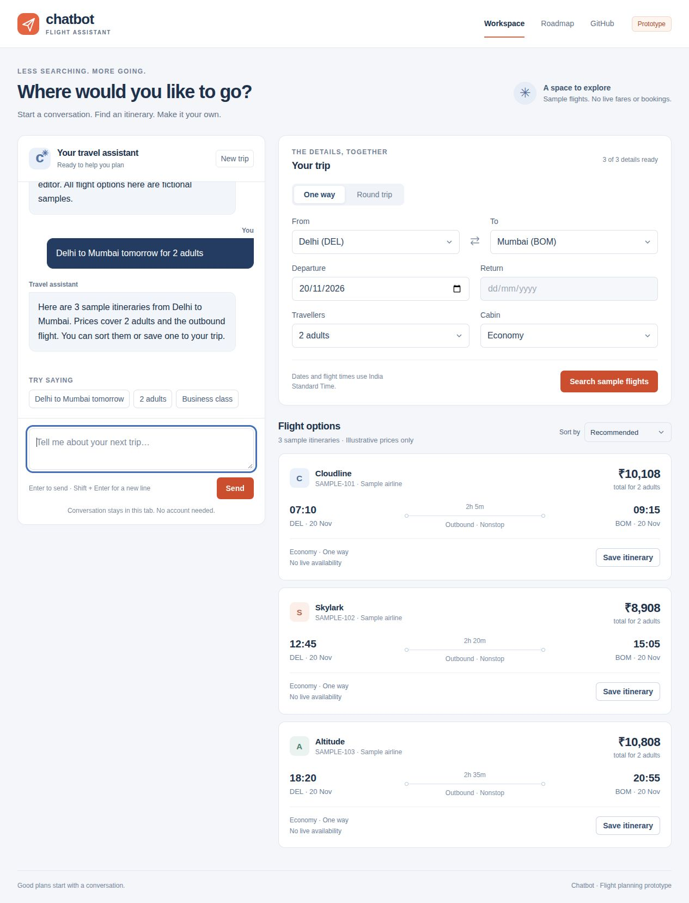
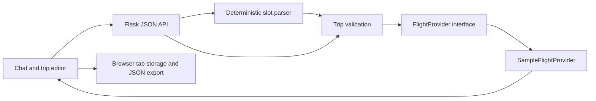

# Chatbot · Flight assistant

A **Python 3.12 flight-planning prototype** with a responsive chat workspace,
an editable trip form, and clearly labeled sample itineraries.

[](https://github.com/mukesh-mehta/Chatbot/actions/workflows/ci.yml)

[**12-feature roadmap**](#feature-roadmap) · [Detailed development plan](ROADMAP.md) · [Frontend plan](docs/FRONTEND.md)

## Feature roadmap

**These 12 features are planned extensions.** The working prototype already offers
chat, an editable trip form, sample flight results, sorting, and local itinerary
export. The next phase builds a **local, collaborative trip-planning workspace**
using fictional flights and synthetic test users. Database storage, accounts,
shared editing, and the other extensions below are not implemented yet.

| # | Planned feature | What will be added | Status |
| --- | --- | --- | --- |
| 1 | **Durable trip workspace and migrations** | Named trips, SQLite persistence, saved offer snapshots, archive/reopen, and safe schema upgrades. | Planned |
| 2 | **Local accounts and trip ownership** | Local test identities, sessions, private workspaces, and ownership checks for every trip operation. | Planned |
| 3 | **Accessible frontend and recoverable drafts** | Focused UI modules, keyboard/mobile journeys, restored drafts, reliable asynchronous state, and browser tests. | Planned |
| 4 | **Multi-city and timezone-aware planning** | Up to six travel legs, searchable local airport data, leg reordering, and correct timezone/date handling. | Planned |
| 5 | **Versioned synthetic schedules and route search** | Fictional schedule datasets, bounded connection search, reproducible results, and pinned inventory versions. | Planned |
| 6 | **Advanced itinerary comparison** | Combined filters, detailed segments and layovers, and comparison of up to three fictional itineraries. | Planned |
| 7 | **Conflict-safe edits and idempotent commands** | Revision checks, safe retries, concurrent-edit detection, and a visible draft-conflict recovery flow. | Planned |
| 8 | **Shared planning and revision history** | Local owner/editor/viewer roles, access revocation, change history, and restoration as a new revision. | Planned |
| 9 | **Portable imports, exports, and tab migration** | Validated JSON import, duplicate previews, printable HTML, and explicit migration from existing tab data. | Planned |
| 10 | **Schedule-change simulation and local alerts** | Replay fictional price/delay/cancellation events, resume local jobs, and inspect deduplicated in-app alerts. | Planned |
| 11 | **Backup, restore, retention, and deletion** | Consistent SQLite backups, checked restoration, restartable cleanup, and documented deletion behavior. | Planned |
| 12 | **Local observability, performance, and recovery** | Local diagnostics, bounded workloads, measured latency/memory, and repeatable interruption/recovery tests. | Planned |

**Build order:** durable trips and frontend foundations; local accounts and safe
edits; multi-city search; comparison and exchange files; collaboration and simulated
updates; then complete recovery and performance verification. Frontend work and
meaningful tests accompany every milestone.

The planned workflows run on one machine after dependency setup. They require
no AI model, live airline API, cloud service, real payment, GPU, or Docker. All
flight inventory remains fictional; conversation handling stays rule-based.

The [full roadmap](ROADMAP.md#twelve-feature-product-roadmap) gives every feature
an ID (F01–F12), dependencies, implementation scope, and acceptance checks. It also
defines six milestones, ten session checkpoints, and proposed measurable targets.
The Python 3.12 prototype runs before any of these extensions is implemented.

## Workspace preview



This update makes the project's flight-assistant concept runnable on a current
Python environment. The original Python 3.6-era Rasa, Goibibo, and Facebook
implementation is preserved in [`legacy/`](legacy/ARCHIVE.md). The supported
application lives in `chatbot/`, `web/`, and the root `run.py`.

**The archived Rasa code has not been ported to Python 3.12.** The maintained
runtime replaces it with a small, deterministic conversation baseline. It does
not load old model files, contact flight suppliers, use an LLM, book tickets,
or collect payment. Sample airlines, fares, durations, and availability are
fictional. See the [migration notes](docs/MIGRATION.md) for the exact boundary.

## Run with Python 3.12

```bash
git clone https://github.com/mukesh-mehta/Chatbot.git
cd Chatbot
python3.12 -m venv .venv
source .venv/bin/activate
python -m pip install -r requirements.txt
python run.py
```

Open **http://127.0.0.1:8000**. No credentials, model download, database, Node.js,
or frontend build is required to run the app. Stop it with Ctrl+C.

On Windows PowerShell, replace the environment commands with:

```powershell
py -3.12 -m venv .venv
.venv\Scripts\Activate.ps1
python -m pip install -r requirements.txt
python run.py
```

You can also run `.venv\Scripts\python.exe run.py` without activating the
environment. The optional Conda definition now selects Python 3.12 and installs
the same requirements: `conda env create -f environment.yml`.

For another local port, use `python run.py --port 8120`.

### Offline use

Prepare the source and install dependencies from available package mirrors or
permitted offline packages before disconnecting. Runtime screens, styles, fonts,
scripts, and sample flight generation use local resources. The native Python
startup above is sufficient; Docker and external accounts are not required.

Use fictional trip inputs. For a source bundle limited to the maintained app,
exclude `legacy/`, local environments, caches, and generated data; retain the root
license and provenance notices. See [third-party notes](THIRD_PARTY_NOTICES.md).
Future browser-test setup must use a browser already available in the target
environment; target-environment validation remains part of the roadmap.

## Try a complete workflow

1. Send **Delhi to Mumbai tomorrow for 2 adults**.
2. Watch the route, departure date, and traveller count fill into the trip editor.
3. Send **business**, or change the cabin in the form and search again.
4. Choose **Round trip**, enter a return date, and search for both legs.
5. Sort by price or duration; save an itinerary and download the JSON trip file.
6. Refresh to restore this tab's conversation and revalidate its trip.
7. Use **New trip** to clear the local conversation and saved selection.

The chat understands supported airport cities/codes, `today`, `tomorrow`,
`day after tomorrow`, ISO dates (`YYYY-MM-DD`), adult counts, and cabin/trip types.
It asks for missing details. This is a deliberately limited parser: use the form
for phrasing it does not recognize. Dates and times use `Asia/Kolkata`.

Supported airports: Delhi, Mumbai, Bengaluru, Hyderabad, Chennai, Kolkata,
Goa (Dabolim), and Kochi. Searches support 1–9 adults and dates within 365 days.

## What is implemented

| Capability | Current behavior |
| --- | --- |
| Python 3.12 runtime | Portable pinned requirements, Flask API, Waitress launcher |
| Conversational planning | Multiple turns, route/date updates, greetings, reset, missing-field questions |
| Shared trip state | Chat and structured form use the same validated trip model |
| Trip validation | Known airports, different endpoints, real/future dates, return ordering, adult limits |
| One-way / round-trip search | Deterministic sample provider; total prices include every adult and leg |
| Frontend workspace | Responsive layout, chat suggestions, editable dates/cabin, airport swap |
| Flight comparison | Price/duration sorting, outbound and return legs, explicit sample-data labels |
| Saved itinerary | One local selection and a JSON download; no reservation is created |
| Tab persistence | Last 40 messages, trip, and selected offer ID in session storage |
| Error handling | Bounded requests, validation feedback, network timeout, retained unsent input |
| Development checks | Python tests, JavaScript tests, Python 3.12 Linux/Windows CI, container smoke check |

The [roadmap](ROADMAP.md) contains the substantially larger remaining scope,
including a dedicated frontend phase and measurable delivery gates. The
[frontend guide](docs/FRONTEND.md) describes the current interface and its limits.

## Architecture



The API is stateless: each request supplies the current trip. There is no shared
in-memory conversation dictionary, so separate requests do not overwrite one
another. The roadmap adds explicit durable revisions, local ownership, shared
editing, and measured resource limits. Its planned provider reads versioned
fictional inventory; live suppliers and booking are outside the active scope.

## API

```bash
curl http://127.0.0.1:8000/api/health

curl -X POST http://127.0.0.1:8000/api/chat \
  -H 'Content-Type: application/json' \
  -d '{"message":"Delhi to Mumbai tomorrow for 2 adults","trip":{}}'
```

Send the returned `trip` with the next message to continue the conversation.
`POST /api/search` accepts the same trip without a chat message.
Responses include `trip`, `reply`, `errors`, `missing_fields`, `offers`,
`search_performed`, and `mode`. [Full API contract](docs/API.md).

## Optional Docker setup

```bash
docker build -t flight-chatbot .
docker run --rm --read-only --tmpfs /tmp -p 127.0.0.1:8000:8000 flight-chatbot
```

This packaging is optional and is not required by the local roadmap milestones.
The image uses Python 3.12 and a non-root user. Only the active application and
runtime dependencies are copied; archived code and serialized models are excluded.
No public hosting or cloud resources are created by these commands.

## Development and verification

Node.js 18+ is only needed for frontend tests/formatting; CI uses Node 20.

```bash
python -m pip install -r requirements-dev.txt
python -m pytest -q
python -m compileall -q chatbot run.py scripts tests
python -m pip check
ruff check .
ruff format --check .
npm ci --ignore-scripts
npm test
npm run format:check
# With the server already running:
python scripts/smoke.py
```

Tests and formatting intentionally exclude `legacy/`. Do not use the archived
requirements file to install the modern application. Runtime versions are
declared in `pyproject.toml` and resolved in `requirements.txt`; development
dependencies are separately recorded in `requirements-dev.txt`.

See [verification](docs/VALIDATION.md) and [contribution guidance](CONTRIBUTING.md).

## Repository layout

```text
chatbot/          Active API, trip validation, conversation, provider boundary
web/              Buildless HTML, CSS, JavaScript workspace
tests/            Python behavior tests and JavaScript state tests
scripts/          Real-HTTP smoke check
docs/             Migration, API, frontend, verification, screenshots
legacy/           Historical code/model archive; credential settings sanitized
ROADMAP.md        Prioritized product and engineering backlog
run.py            Supported Python 3.12 entry point
```

New implementation code is MIT licensed. Historical third-party material under
`legacy/` is excluded from that grant; its original notices and terms remain
applicable. See [LICENSE](LICENSE) and [third-party notes](THIRD_PARTY_NOTICES.md).
